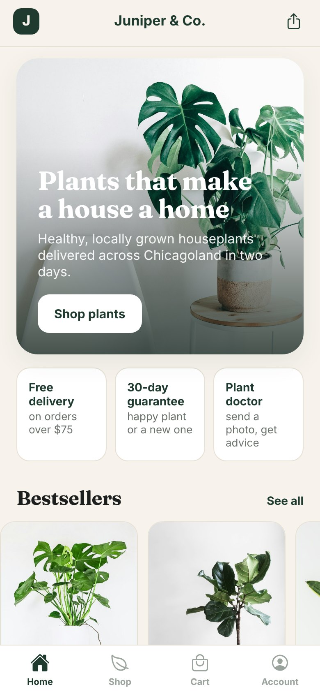
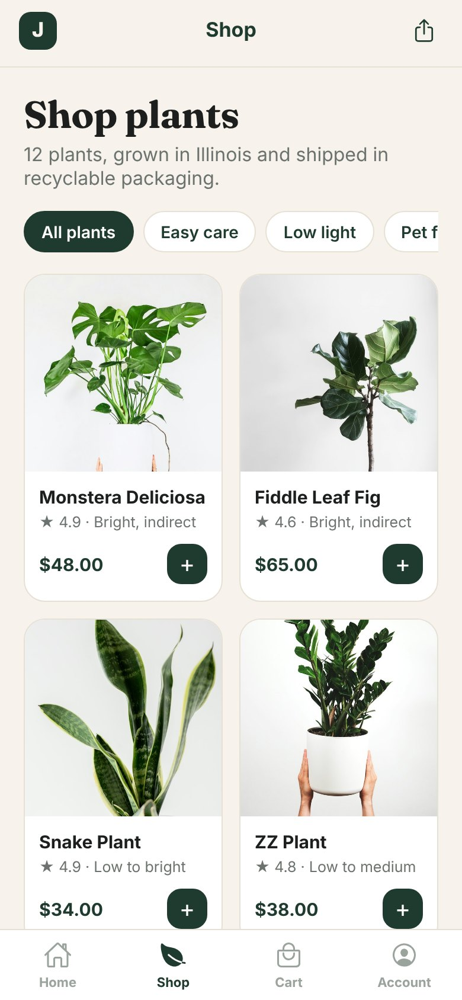
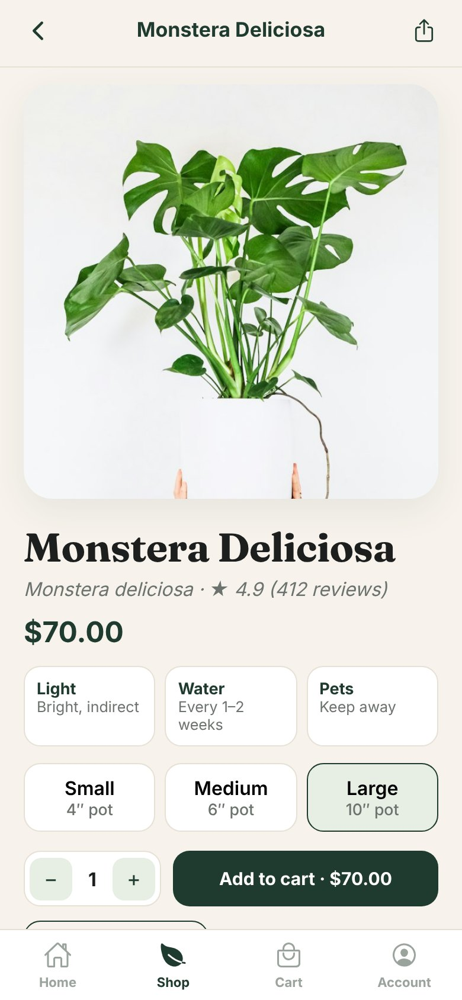
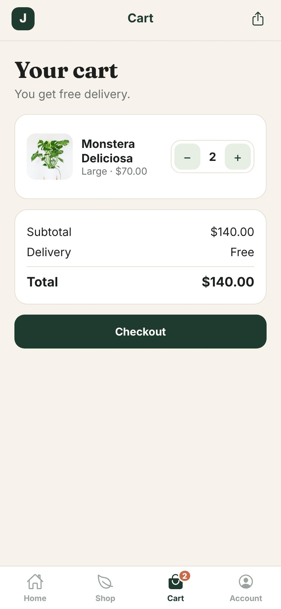
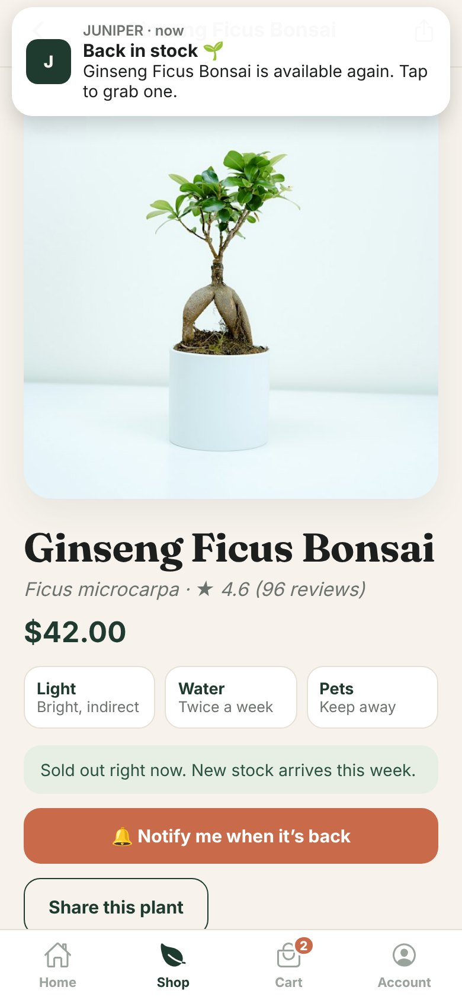
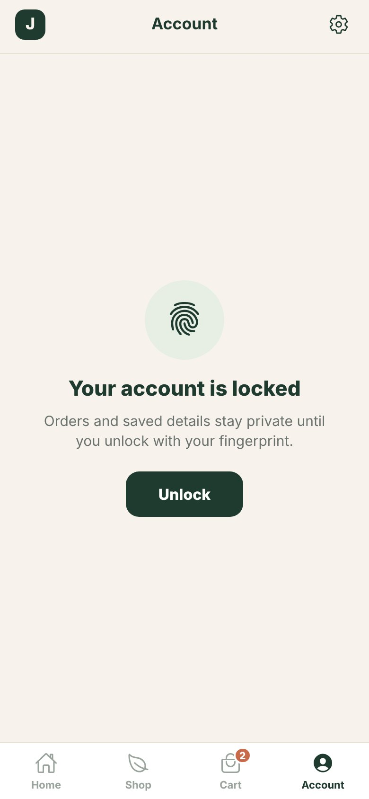
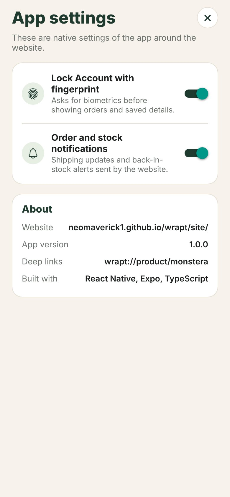
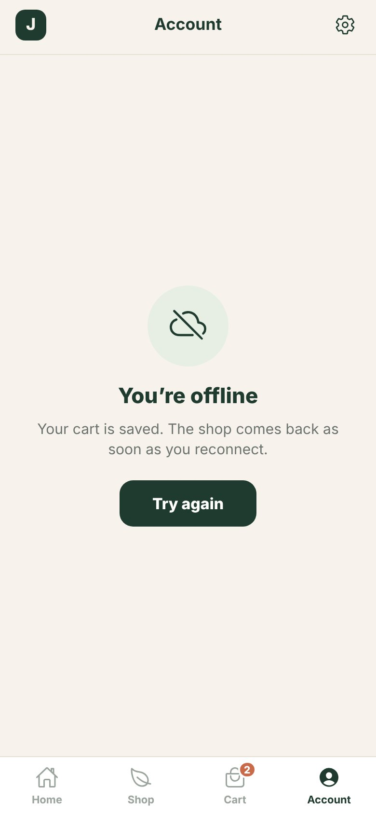
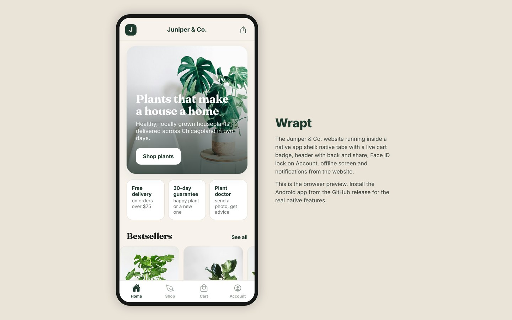

# Wrapt: website-to-app (React Native)

Wrapt turns an existing website into a real **iPhone and Android app** with **React Native (Expo) + TypeScript**. The website keeps running as it is, and the app adds what a browser can't: native tabs with a live cart badge, a native header with back and share, **Face ID / fingerprint lock**, **push-style notifications sent by the website**, camera access, deep links, haptics and an offline screen.

The demo wraps **Juniper & Co.**, a plant shop website made for this project (it's in [`site/`](site/)). The app installs as **Juniper**.

<p>
  
  
  
  
</p>
<p>
  
  
  
  
</p>

## Try it

| Platform                      | How                                                                                                                                |
| ----------------------------- | ---------------------------------------------------------------------------------------------------------------------------------- |
| **Web preview (any browser)** | [neomaverick1.github.io/wrapt](https://neomaverick1.github.io/wrapt/)                                                              |
| **The website on its own**    | [neomaverick1.github.io/wrapt/site](https://neomaverick1.github.io/wrapt/site/)                                                    |
| **Android**                   | Download `Juniper.apk` from the [latest release](https://github.com/neomaverick1/wrapt/releases/latest) and open it on your phone. |
| **iPhone simulator (Mac)**    | Download `Juniper-iOS-Simulator.zip` from the same release, unzip it and drag `Juniper.app` onto a booted simulator.               |

Things to try: add a plant to the cart and watch the tab badge, tap **Notify me** on the sold-out bonsai (a notification arrives a few seconds later and opens the plant when tapped), open **Account** (it asks for your fingerprint or Face ID), and switch on airplane mode.

Every push to `main` type-checks, lints and tests the code, then rebuilds the Android app, the iOS simulator app and the web version automatically ([`.github/workflows/build.yml`](.github/workflows/build.yml)).



## Features

| Area                      | What it does                                                                                                                                                                                                                                                                                                                         |
| ------------------------- | ------------------------------------------------------------------------------------------------------------------------------------------------------------------------------------------------------------------------------------------------------------------------------------------------------------------------------------ |
| **Native shell**          | A native header with the page's title, a back button whenever the site can go back and a share button that opens the phone's share sheet. A loading bar, pull to refresh, and the Android back button steps back through the site before it leaves the app. The site's own header and footer hide inside the app so it feels native. |
| **Native tabs**           | Home, Shop, Cart and Account tabs that open the matching part of the website, with a cart badge that updates the moment the site's cart changes.                                                                                                                                                                                     |
| **Face ID / fingerprint** | The Account tab is locked behind Face ID, Touch ID or a fingerprint, and locks again whenever the app goes to the background so the app switcher never shows it. It can be turned off in App settings.                                                                                                                               |
| **Notifications**         | The website asks the app for notifications: a back-in-stock alert from **Notify me** and a "your plants have shipped" alert after checkout. Tapping one opens the right page.                                                                                                                                                        |
| **Camera and photos**     | The website's photo upload (Plant doctor on the Account page) opens the camera or photo library inside the app, with the iOS and Android permission prompts set up.                                                                                                                                                                  |
| **Offline and errors**    | An offline screen as soon as the connection drops and a retry screen if the site fails to load. The cart stays saved on the phone.                                                                                                                                                                                                   |
| **Links**                 | Deep links such as `wrapt://product/monstera` open that page in the app. Links to other websites open in the phone's browser.                                                                                                                                                                                                        |
| **Haptics**               | A light tap on tab changes and a success buzz when something goes in the cart or an order is placed.                                                                                                                                                                                                                                 |
| **App settings**          | A native settings screen for the biometric lock and notifications, saved on the phone, plus the app version and website.                                                                                                                                                                                                             |

## How the app and the website talk

- **Website → app**: the site sends small JSON messages (`route`, `cart`, `share`, `notify`, `haptic`). The app treats them as untrusted input: [`src/lib/bridge.ts`](src/lib/bridge.ts) checks every field (page paths, counts, https-only share links, notification delays) and drops anything else.
- **App → website**: the app calls `window.WraptBridge.receive(...)` to open a page from the native tabs, a deep link or a notification.
- **The site still works on its own**: it only turns on the native features when it runs inside the app, so the same website serves browsers and the app. The bridge is a small script at the top of [`site/app.js`](site/app.js).
- **Web preview**: in a browser the app shows the website in an iframe and the same messages travel over `postMessage`. Features that need a phone fall back gracefully: notifications appear as an in-app banner and the lock screen explains that Face ID and fingerprint run on the phone.

## Wrapping a different website

1. Set `SITE_URL` and the tab paths (`TABS`) in [`src/lib/links.ts`](src/lib/links.ts).
2. Set the app name, icon, colors, bundle IDs and permission texts in [`app.json`](app.json).
3. Add the bridge to the website so it can report its page, cart and notifications (see the top of [`site/app.js`](site/app.js)).

## Run it

Requires Node 20+.

```bash
npm install
npm start          # then press a (Android), i (iOS simulator) or w (web)
```

## Checks

```bash
npm run typecheck  # TypeScript, strict mode
npm run lint       # ESLint (Expo config)
npm test           # bridge message validation, links and deep links, tabs
```

## Project structure

```
site/                     The Juniper & Co. website (plain HTML, CSS and JavaScript)
  app.js                  Shop, cart, checkout and the bridge to the app
src/
  app/
    index.tsx             The app shell: header, tabs, lock, offline screen, notifications, deep links
    settings.tsx          Native app settings
  components/
    WebShell.native.tsx   The website in a native WebView (iPhone and Android)
    WebShell.tsx          The website in an iframe (web preview)
  lib/
    bridge.ts             Checks every message from the website
    links.ts              Website address, tabs, deep links, outside links
    native.ts             Share sheet, haptics, notifications, Face ID / fingerprint
    useOnline.ts          Online and offline status
  state/settings.tsx      App settings saved on the phone
__tests__/                Unit tests
```

## Credits

Plant photos from [Unsplash](https://unsplash.com) (Unsplash License). Fonts: Fraunces and Inter (SIL Open Font License) from Google Fonts. Icons: Ionicons. Juniper & Co. is a made-up shop; products, prices and reviews are sample data.

## License

MIT © 2026 Randy Kundinger (code). Photos and fonts remain under their own licenses.
